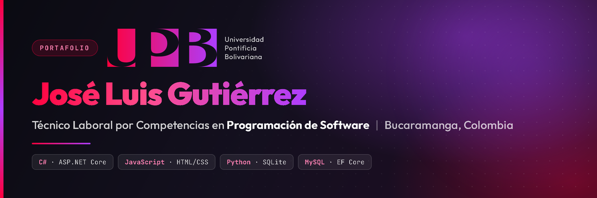
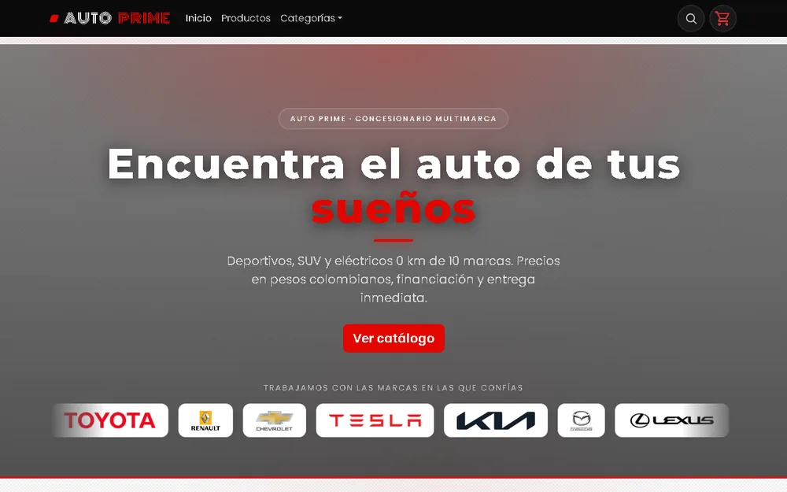
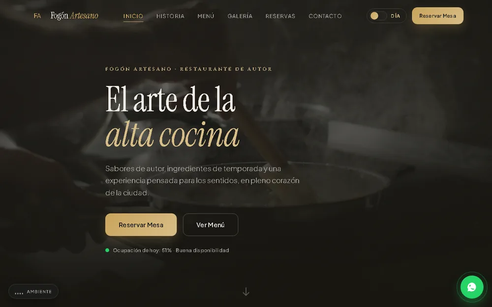
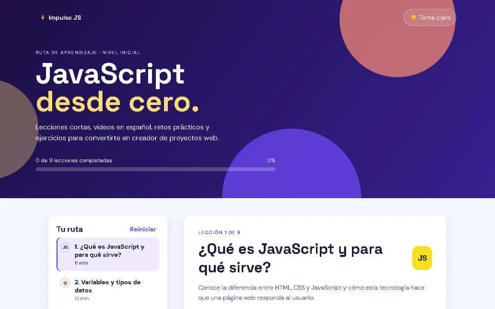
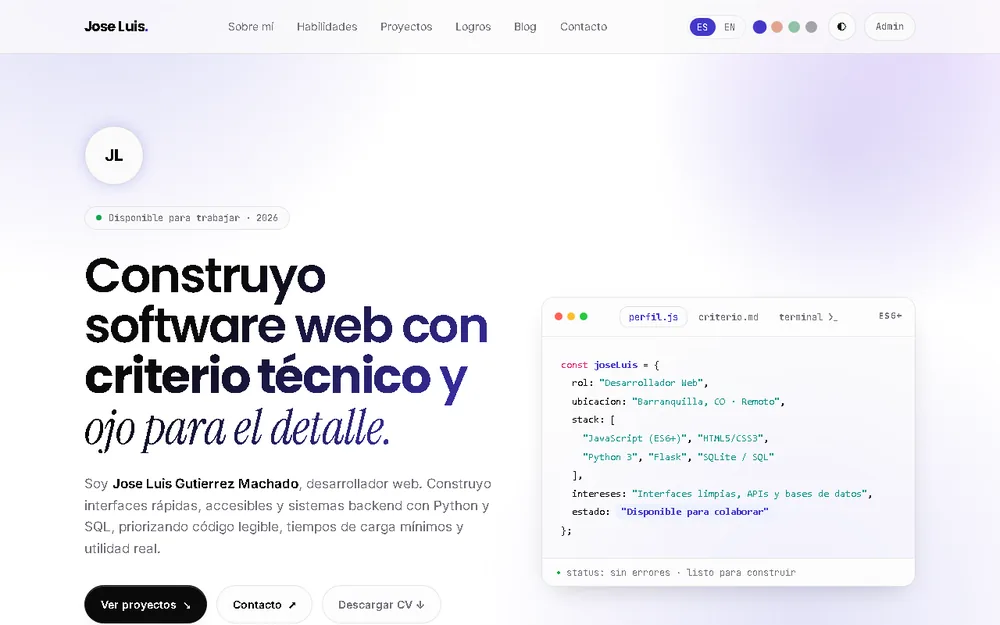

 

# Hola, soy José Luis Gutiérrez 👋

**Técnico Laboral por Competencias en Programación de Software**
*Universidad Pontificia Bolivariana · Bucaramanga, Santander, Colombia*

Construyo software web completo: APIs en C#, interfaces en JavaScript y utilidades
de escritorio en Python. Me obsesionan el código legible, la arquitectura por capas
y las interfaces que se sienten rápidas.

[Ver proyectos](#-proyectos-destacados) · [Contacto](#-contacto)

 

## 🚀 En qué estoy trabajando ahora

- 🛠️ **Consolidando C# y .NET** — después de `ApiPrimera` quiero ir más profundo en LINQ y async.
- 🌐 **Terminando el módulo de Diseño de Interfaces** — accesibilidad y diseño responsive como prioridad.
- 📚 **Ruta de JavaScript** — `Impulso JS` va por la lección 5 de 9; el objetivo es llegar al proyecto final.
- 🎯 **Meta 2026**: terminar el TEC y empezar a buscar **prácticas o becario junior**.

 

## 📫 Contacto

 

## 🛠️ Stack tecnológico

---

## 💻 Proyectos destacados

### 🌟 Spotlight — Auto Prime (API REST + e-commerce)

**API REST de productos en ASP.NET Core (.NET 10)** con Entity Framework Core, MySQL y
persistencia de imágenes en Cloudinary. Incluye storefront propio (catálogo, categorías,
carrito y checkout), administración de productos y **71 pruebas automatizadas en verde**.

| | |
| :--- | :--- |
| **Stack** | C# · ASP.NET Core · EF Core · MySQL · Cloudinary · HTML · CSS · JS |
| **Repositorio** | [joseluisgutierrezestudiante/ApiPrimera](https://github.com/joseluisgutierrezestudiante/ApiPrimera) |
| **Estado** | ✅ Completo — taller 3 aprobado |

 

### 🍽️ Fogón Artesano (sitio de restaurante)

Sitio editorial de un restaurante de autor de Bucaramanga. Menú interactivo con filtros de
alérgenos, plano de mesas para reservas, galería con lightbox, modo día/noche persistente
y animaciones GSAP. Diseño responsive y accesible (teclado y `prefers-reduced-motion`).

| | |
| :--- | :--- |
| **Stack** | HTML · CSS · JavaScript · GSAP |
| **Repositorio** | [joseluisgutierrezestudiante/Restaurante-](https://github.com/joseluisgutierrezestudiante/Restaurante-) |
| **Estado** | ✅ Completo |

 

### ⚡ Impulso JS (ruta de aprendizaje)

Ruta de **JavaScript desde cero** en español: 9 lecciones con video, laboratorio de código
ejecutable, retos prácticos, mini quizzes y progreso guardado en el navegador. Sin instalar nada.

| | |
| :--- | :--- |
| **Stack** | HTML · CSS · JavaScript · localStorage |
| **Repositorio** | [joseluisgutierrezestudiante/JavaAprendizaje](https://github.com/joseluisgutierrezestudiante/JavaAprendizaje) |
| **Estado** | ✅ Completo — lección 5 de 9 |

 

### 🛡️ DataGuard CLI (integridad de archivos)

Utilidad de línea de comandos en Python para auditoría de archivos: genera una **línea base
de hashes SHA-256**, detecta archivos modificados, agregados o eliminados, persiste el
historial en **SQLite** y exporta reportes en JSON. Arquitectura por capas limpia.

| | |
| :--- | :--- |
| **Stack** | Python · SQLite · SHA-256 · argparse |
| **Repositorio** | [joseluisgutierrezestudiante/dataguard-cli](https://github.com/joseluisgutierrezestudiante/dataguard-cli) |
| **Estado** | ✅ Estable |

 

### 📁 Portafolio personal

Portafolio mobile-first con **modo oscuro persistente**, **internacionalización ES/EN**,
gestor de proyectos (CRUD demo en `localStorage`), blog, formulario de contacto validado
y descarga de CV. También incluye un API de mascotas en Flask con SQL.

| | |
| :--- | :--- |
| **Stack** | HTML · CSS · JavaScript · Flask · SQL |
| **Repositorio** | [joseluisgutierrezestudiante/mi-portafolio](https://github.com/joseluisgutierrezestudiante/mi-portafolio) |
| **Estado** | ✅ Activo |

 

### 📦 Otros proyectos

| Proyecto | Descripción | Stack |
| :--- | :--- | :--- |
| [**E-Commerce**](https://github.com/joseluisgutierrezestudiante/ecommerce) | Tienda en línea con ASP.NET Core MVC, carrito en sesión y control de stock | C# · EF Core · MySQL |
| [**JGO Invasores**](https://github.com/joseluisgutierrezestudiante/JGO-Invasores) | Clon de Space Invaders en Python con pygame; sprites y audio generados por código | Python · pygame |
| [**Piedra, Papel o Tijera**](https://github.com/joseluisgutierrezestudiante/PIEDRA-PAPEL-Y-TIJERA) | Juego de consola con estadísticas persistidas en JSON y pruebas unitarias | Python · JSON |
| [**POO — Actividad Perro**](https://github.com/joseluisgutierrezestudiante/POO-actividad-perro) | Jerarquía de clases que demuestra los 4 pilares de la POO | Python · POO |
| [**Mi lista de tareas**](https://github.com/joseluisgutierrezestudiante/mi-tienda) | CLI de gestión de tareas: CRUD, búsqueda, estadísticas y persistencia local | Node.js · JSON |

---

## 🎓 Formación

**Técnico Laboral por Competencias en Programación de Software**
Universidad Pontificia Bolivariana — Sede Bucaramanga

| Materia | Estado |
| :--- | :--- |
| Fundamentos de Programación — lógica de control, algoritmos y resolución de problemas | ✅ Completada |
| Herramientas y Lenguaje de Programación — lenguajes y entornos de desarrollo | ✅ Completada |
| Programación Orientada a Objetos — clases, encapsulamiento, herencia y diseño modular | ✅ Completada |
| Fundamentos de Bases de Datos — modelado de datos, relaciones y persistencia | ✅ Completada |
| Humanismo — ética profesional y responsabilidad social | ✅ Completada |
| Desarrollo Web — HTML, CSS y JavaScript aplicados a sitios reales | 🚀 En curso |
| Diseño de Interfaces de Usuario — usabilidad, jerarquía visual y experiencia | 🚀 En curso |

 

## 🎯 Enfoque

| Área | Qué hago |
| :--- | :--- |
| **Back-end** | APIs REST en ASP.NET Core con EF Core, MySQL y pruebas automatizadas |
| **Front-end** | Interfaces responsive con HTML, CSS, JavaScript y animaciones |
| **Datos** | Modelado relacional, persistencia en SQLite/MySQL e integridad con SHA-256 |
| **Arquitectura** | Separación por capas, código legible y herramientas de CLI bien definidas |
| **Diseño** | Jerarquía visual, consistencia, accesibilidad y modo oscuro |

---

## 📊 Actividad y estadísticas

  

  

<picture>
  <source media="(prefers-color-scheme: dark)" srcset="https://raw.githubusercontent.com/joseluisgutierrezestudiante/joseluisgutierrezestudiante/output/github-snake-dark.svg" />
  <source media="(prefers-color-scheme: light)" srcset="https://raw.githubusercontent.com/joseluisgutierrezestudiante/joseluisgutierrezestudiante/output/github-snake.svg" />
  
</picture>

---

## 🏆 Trofeos de GitHub

---

**¿Tienes un proyecto en mente?** [Escríbeme](mailto:joseluismachado09@gmail.com) y lo construimos.

 

> *"El código se lee mucho más veces de lo que se escribe. Que sea legible no es un lujo, es el primer requisito."*

Perfil en construcción: aprendo creando.

